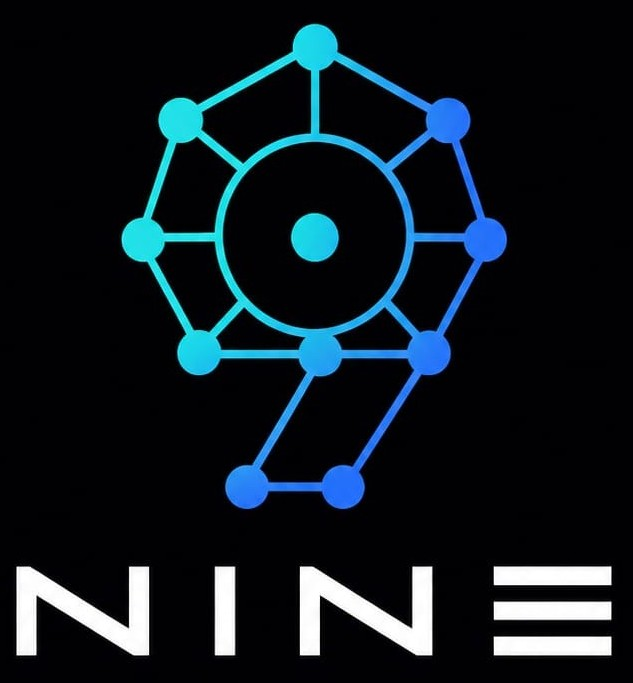
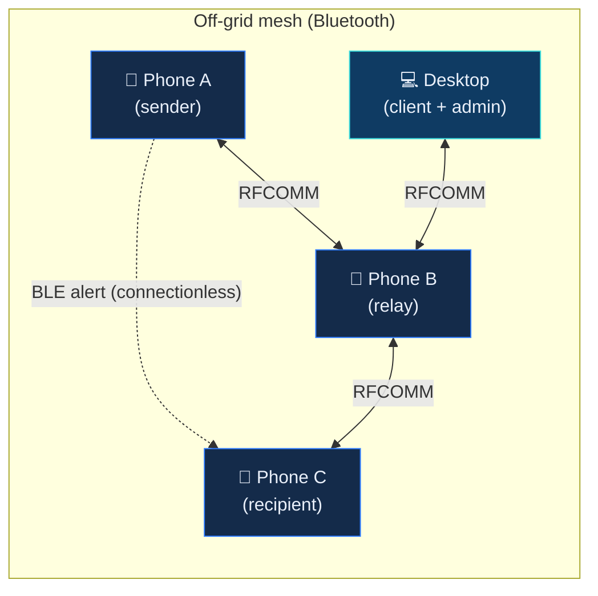
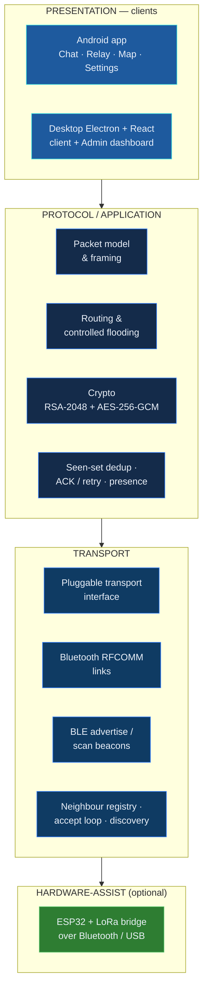
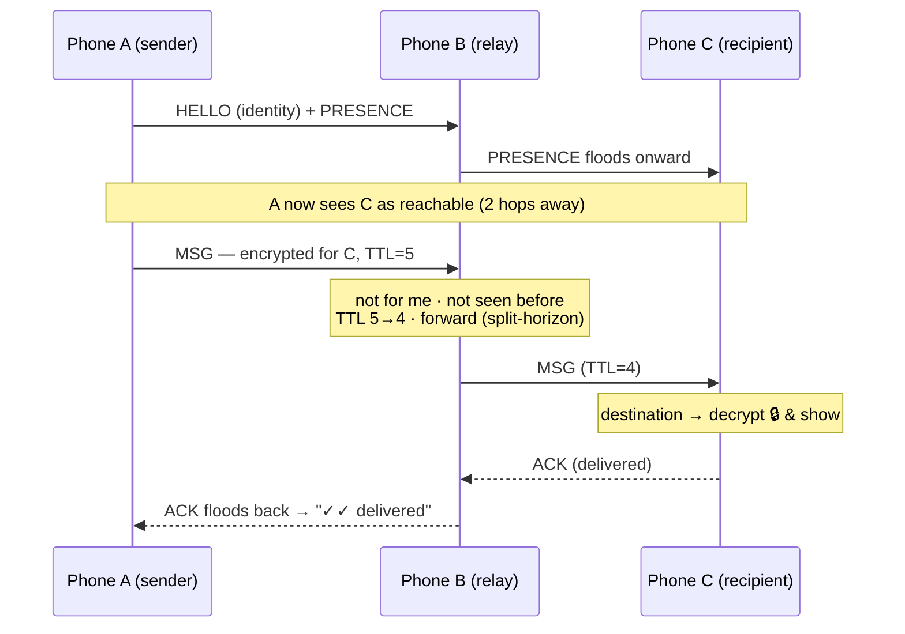
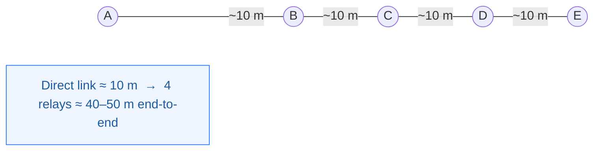
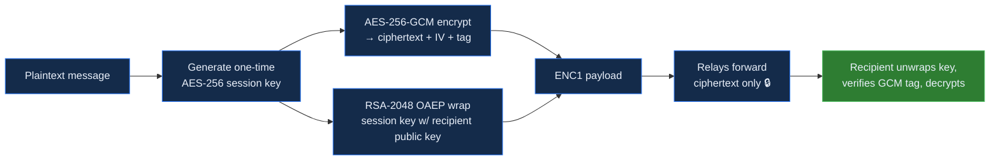

<div align="center">



# NINE — No Network Infrastructure Exchange

**Communicate when every network is down.**
An infrastructure-free mesh that lets phones — and desktops — talk over Bluetooth with **no internet, no cell tower, no Wi‑Fi, no SIM, and no server.**

<!-- badges -->


</div>

---

## Table of Contents

- [Why NINE](#why-nine)
- [What NINE is](#what-nine-is)
- [System at a glance](#system-at-a-glance)
- [Architecture](#architecture)
- [How a message travels](#how-a-message-travels)
- [The range problem & the relay solution](#the-range-problem--the-relay-solution)
- [Connectionless BLE alerts](#connectionless-ble-alerts)
- [Packet & beacon formats](#packet--beacon-formats)
- [Security model](#security-model)
- [Components](#components)
- [Build & run](#build--run)
- [Repository layout](#repository-layout)
- [Documentation](#documentation)
- [Roadmap](#roadmap)
- [Team & license](#team--license)

---

## Why NINE

When a flood, earthquake, or cyclone knocks out towers and backhaul — or when a festival crowd overloads the cell network, or you're simply off-grid in the mountains — ordinary messaging stops working. **People become isolated at the exact moment they most need to reach one another.**

NINE turns the phones people already carry into a self-forming communication network. No infrastructure. No accounts. No central server. Just radios talking to radios, relaying for one another to cover distance.

---

## What NINE is

NINE is a **protocol first, apps second** — the same way TCP/IP is independent of the browser on top of it. One wire protocol is spoken by multiple clients:

| Client | Platform | Role |
|--------|----------|------|
| **NINE mobile** | Android (Java) | The field device — chat, relay, offline map, SOS |
| **NINE desktop** | Windows (Electron + React + TypeScript) | Full mesh client **and** a token-gated admin/monitoring dashboard |
| **NINE core** | TypeScript | Reference protocol engine: packets, routing, crypto, transport, simulator |
| **Bluetooth helper** | C# / WinRT | Gives the desktop real Windows RFCOMM + BLE radio access |

Everything is **offline by design** — the internet is used only (optionally) to pre-download map tiles.

---

## System at a glance



A message from **A** can reach **C** even when they're out of direct Bluetooth range — **B relays it**. Short emergency alerts can also ripple outward as connectionless BLE advertisements that need no pairing at all.

---

## Architecture

NINE is layered so each layer is independently replaceable (a new transport or a new client doesn't touch the protocol).



> Deep dive: [`docs/Architecture.md`](docs/Architecture.md) · [`docs/android.md`](docs/android.md) · [`docs/SDK.md`](docs/SDK.md)

---

## How a message travels

Every device is equal — it can send, receive, **and** relay at the same time. A targeted message is encrypted end-to-end, so relays only ever carry ciphertext they cannot read.



**The forwarding rule (controlled flooding):** on receiving a packet a node (1) drops it if the `msgId` is already in its **seen-set**, (2) delivers it if it's the destination, else (3) decrements **TTL** and re-broadcasts to its other neighbours — so loops and broadcast storms can't happen.

> Deep dive: [`docs/Routing.md`](docs/Routing.md) · [`Relay.md`](Relay.md)

---

## The range problem & the relay solution

A single Bluetooth Class‑2 link reaches only **~10 m**, and less through walls. NINE beats this by chaining relays: each device only needs to reach its **immediate neighbour**, and distance scales with the number of hops.



A **Relay Mode** turns a phone into a hands-off forwarder (auto-accept, auto-connect, foreground service) with a single tap — place it between two endpoints and it quietly carries traffic.

---

## Connectionless BLE alerts

Beyond connected chat, NINE can broadcast a short **emergency alert** over BLE advertisements — **no pairing, no connection**. Any nearby device running NINE hears it, and re-broadcasts it onward (hop-limited controlled flooding) so the alert ripples out for range.

- **Capability-adaptive:** uses **BLE 5 Extended Advertising** when the radio supports it (measured 160–1650 bytes on our test devices), and falls back to legacy advertising otherwise.
- **Hop-limited:** each alert carries a `msgId` + `TTL`; relays re-advertise with `TTL-1` after a small random jitter to avoid on-air collisions.
- **Honest limits:** connectionless alerts are short, unencrypted, and fire-and-forget (no delivery receipt). They complement — never replace — the reliable, encrypted RFCOMM path.

---

## Packet & beacon formats

NINE keeps **one byte-compatible wire format** across phone and desktop. Three layers are illustrated below.

**1 · Binary packet — fixed 71-byte header (reference core engine)**

```
 0        1        2        3                 19                35                51        55                 63   64   65        67        71
 ┌────────┬────────┬────────┬─────────────────┬─────────────────┬─────────────────┬────────┬──────────────────┬────┬────┬─────────┬─────────┬─────────┐
 │version │ type   │ flags  │ packetId (16B)  │ senderId (16B)  │ destId (16B)    │ seq 4B │ timestamp 8B     │TTL │hop │ payLen  │ CRC-32  │ payload │
 └────────┴────────┴────────┴─────────────────┴─────────────────┴─────────────────┴────────┴──────────────────┴────┴────┴─────────┴─────────┴─────────┘
                                                                                                        (+ optional 64-byte signature if SIGNED)
```

**2 · Mesh packet (Android) — length-prefixed JSON frame**

```
┌─────────────┬───────────────────────────────────────────────────────────────┐
│ 4-byte BE   │  { type, msgId, srcId, dstId, ttl, seq, name, pubKey,          │
│ length      │    payload, lat, lon, timestamp }   ← UTF-8 JSON               │
└─────────────┴───────────────────────────────────────────────────────────────┘
```

**3 · Encrypted payload (ENC1)**

```
ENC1 : base64(RSA-OAEP-wrapped AES key) : base64(12-byte IV) : base64(AES-256-GCM ciphertext ‖ tag)
```

**4 · BLE alert beacon (v2) — 16-byte header + body**

```
┌───┬────┬──────────┬──────┬───────┬────┬────────┬──────────────┐
│ver│kind│ srcId8 8B│seq 2B│msgId 2B│ttl │ bodyLen│ body (≤130B) │
└───┴────┴──────────┴──────┴───────┴────┴────────┴──────────────┘
         (msgId + ttl drive controlled-flooding re-broadcast)
```

> Full spec: [`docs/PacketFormat.md`](docs/PacketFormat.md) · [`docs/NINE-PacketEncoding-v1.0.md`](docs/NINE-PacketEncoding-v1.0.md)

---

## Security model



- **End-to-end:** only the intended recipient can decrypt. Relays route on IDs they can see, but the body is opaque to them.
- **Integrity:** AES-GCM authentication tag + a CRC-32 on the binary packet.
- **Identity:** every install generates a stable UUID; display names are cosmetic, routing uses the ID.
- **Not hidden (v1):** routing metadata (who → whom) is visible to relays; onion-style metadata privacy is future work.

> Deep dive: [`docs/Security.md`](docs/Security.md)

---

## Components

### 📱 Android app (`app/`)
Java, minSdk 23 / targetSdk 34. Chat · Relay · Map · Settings tabs. Bluetooth Classic RFCOMM mesh, BLE presence + alerts, end-to-end encryption, delivery ACKs, offline OpenStreetMap (osmdroid) with GPS peer pins, and offline routing (GraphHopper).

### 💻 Desktop app (`admin/`)
Electron + React + TypeScript. Acts as a **full mesh client** (send/receive/relay) and, behind an access token, an **admin dashboard** (live packet log, mesh topology, delivery metrics, node health). Talks to real Windows Bluetooth through a bundled **C# WinRT helper** (`admin/bthelper/`).

### 🧩 Protocol core (`core/`)
The reference TypeScript engine: `protocol/` (packet, serializer, parser, CRC-32), `routing/`, `security/` (RSA/AES), `transport/` (Bluetooth abstraction, mock + virtual), `messaging/` (dual-path), and a `simulator/` for repeatable mesh metrics.

### 📡 Range bridge (optional)
ESP32 + LoRa node bridged to a phone over Bluetooth/USB to extend reach where phone radios can't.

---

## Build & run

### Android app
```bash
# from repo root (Android SDK required; set sdk.dir in local.properties)
gradlew assembleDebug
# install app/build/outputs/apk/debug/app-debug.apk and grant Bluetooth + Location
```

### Desktop app (Windows)
```bash
cd admin
npm install
npm run build:helper     # builds the C# WinRT Bluetooth helper (.NET SDK required)
npm run build            # builds main + renderer
npm start                # launches the Electron app
# package a shareable installer:
npm run dist             # → admin/release/NINE Desktop Setup <version>.exe
```

### Protocol core (tests / simulation)
```bash
npm install
npm test                 # vitest unit tests
npx tsx core/simulator/metrics-runner.ts   # simulated mesh QoS metrics
```

---

## Repository layout

```
Project_NINE/
├── app/        Android application (Java)
├── admin/      Desktop app — Electron + React + TS, with bthelper/ (C# WinRT)
├── core/       TypeScript protocol engine (protocol, routing, security, transport, simulator)
├── gateway/    Platform ↔ core bridge interfaces
├── docs/       Full technical documentation (see below)
├── assets/     Logo, icons, screenshots
├── Relay.md    Multi-hop relay design
└── README.md   You are here
```

> Full map: [`docs/File-Structure.md`](docs/File-Structure.md)

---

## Documentation

| Topic | Document |
|-------|----------|
| System architecture | [`docs/Architecture.md`](docs/Architecture.md) |
| Core API / SDK | [`docs/API.md`](docs/API.md) · [`docs/SDK.md`](docs/SDK.md) |
| Protocol & RFC | [`docs/Protocol.md`](docs/Protocol.md) · [`docs/NINE-RFC-v1.0.md`](docs/NINE-RFC-v1.0.md) |
| Packet encoding | [`docs/PacketFormat.md`](docs/PacketFormat.md) · [`docs/NINE-PacketEncoding-v1.0.md`](docs/NINE-PacketEncoding-v1.0.md) |
| Routing & mesh | [`docs/Routing.md`](docs/Routing.md) · [`Relay.md`](Relay.md) |
| Transport (Bluetooth) | [`docs/Transport.md`](docs/Transport.md) · [`docs/BluetoothTransport.md`](docs/BluetoothTransport.md) |
| Security | [`docs/Security.md`](docs/Security.md) |
| Android internals | [`docs/android.md`](docs/android.md) |
| Benchmarks & timing | [`docs/Benchmarks.md`](docs/Benchmarks.md) · [`docs/NINE-Timing-v1.0.md`](docs/NINE-Timing-v1.0.md) |
| Error codes / versioning | [`docs/NINE-ErrorCodes-v1.0.md`](docs/NINE-ErrorCodes-v1.0.md) · [`docs/NINE-Versioning-v1.0.md`](docs/NINE-Versioning-v1.0.md) |

*(The original Android-only README is preserved at [`docs/README-legacy.md`](docs/README-legacy.md).)*

---

## Roadmap

**Done**
- [x] Multi-hop relay mesh (controlled flooding: TTL + seen-set + split-horizon)
- [x] End-to-end encryption (RSA-2048 + AES-256-GCM), delivery ACKs with retries
- [x] Presence propagation & "people online" contacts; targeted, encrypted messaging
- [x] Relay Mode with foreground service; offline map + GPS peer sharing
- [x] Desktop client + token-gated admin dashboard over real Windows Bluetooth
- [x] Connectionless BLE alerts with capability-adaptive **extended advertising** + re-broadcast relay

**Planned**
- [ ] Wi-Fi Direct high-speed transport path
- [ ] Store-and-forward under heavy churn
- [ ] Metadata privacy (hide who is talking to whom)
- [ ] ESP32 + LoRa range-extension bridge, field-validated at distance

---

## Team & license

Built by **Vikas Tiwari · Om Singh** (Thakur College of Engineering and Technology).

Licensed under the **MIT License** — see [`LICENSE`](LICENSE).

<div align="center">
<br/>
<sub><b>NINE</b> — because communication shouldn't stop when the network does.</sub>
</div>
