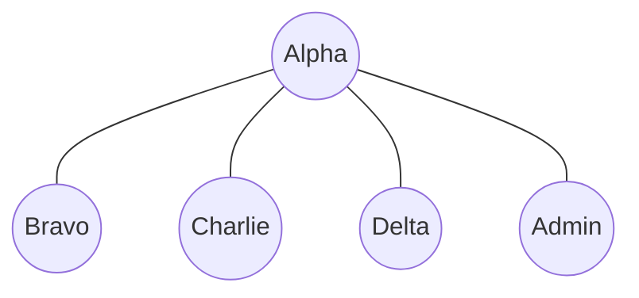
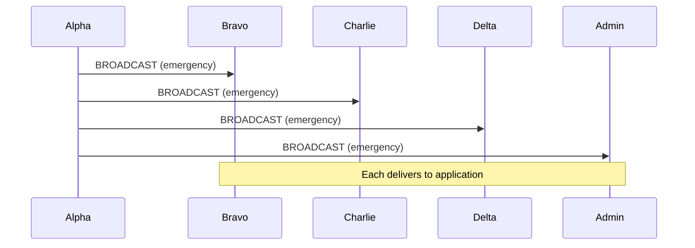

# Example 01 — Broadcast Messaging

## Objective

Demonstrate one-to-all message delivery through the `NineCore` public API.
A single node broadcasts an emergency alert; all peers receive it.

## Network Topology

Star topology — Alpha at the center, connected to 4 peers.



## Message Flow



## Prerequisites

- Node.js 20+
- Dependencies installed (`npm install`)

## How to Run

```bash
npm run demo 1
# or the complete suite:
npm run demo 8
```

## Expected Behaviour

Alpha sends one emergency broadcast. All 4 peers receive the exact message
with the emergency flag set. No routing or encryption is involved — this is
direct one-hop flooding to all connected neighbors.

## Success Criteria

- All 4 peers receive the broadcast (delivery rate = 100%).
- The message content is intact.
- `summary.success === true`.

## Outputs

- `results/logs/01-broadcast.log`
- `results/traces/01-broadcast.trace.json`
- `results/metrics/01-broadcast.metrics.json`
- `results/metrics/01-broadcast.summary.json`
