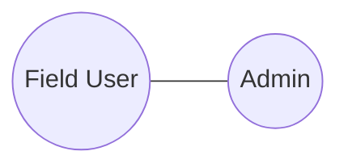
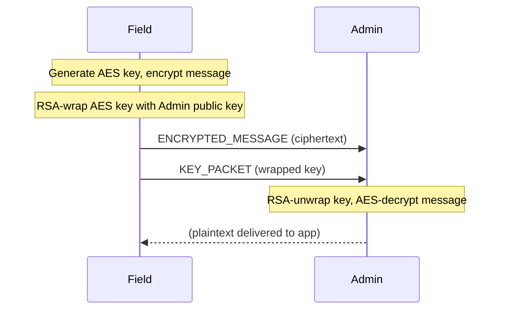

# Example 02 — Secure Messaging

## Objective

Demonstrate encrypted user-to-Admin messaging through `NineCore`. The message
is encrypted with AES-256-GCM and the session key is wrapped with the Admin's
RSA-2048 public key. Only the Admin can decrypt.

## Network Topology



## Message Flow



## Prerequisites

- Node.js 20+
- The Admin's public key must be distributed to the Field node (simulated via `distributeAdminKey()`).

## How to Run

```bash
npm run demo 2
```

## Expected Behaviour

The Field node encrypts a report and sends it. The Admin receives, decrypts,
and the plaintext exactly matches the original. No relay can read the content.

## Success Criteria

- Admin receives exactly one secure message.
- Decrypted plaintext equals the original.
- `summary.success === true`.

## Outputs

- `results/logs/02-secure-message.log`
- `results/traces/02-secure-message.trace.json`
- `results/metrics/02-secure-message.metrics.json`
- `results/metrics/02-secure-message.summary.json`
