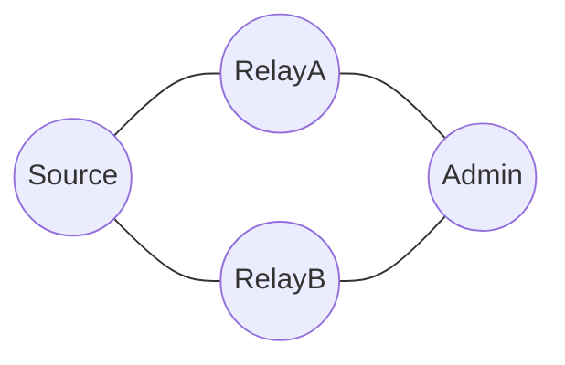
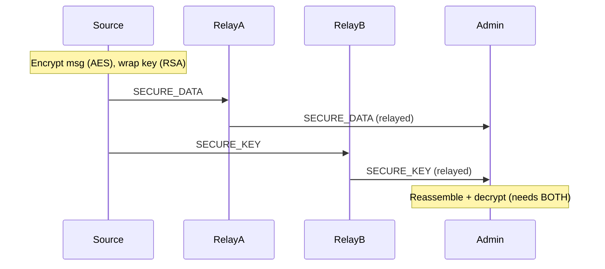

# Example 03 — Dual-Path Secure Messaging

## Objective

Demonstrate NINE's defining feature: a secure message is split into two
independent packets — `SECURE_DATA` (AES ciphertext) and `SECURE_KEY`
(RSA-wrapped session key) — that travel to the Admin and are reassembled and
decrypted only there. A single compromised relay never holds both halves.

## Network Topology

Diamond — two relay paths between Source and Admin.



## Message Flow



## Prerequisites

- Node.js 20+
- Admin public key distributed to Source.

## How to Run

```bash
npm run demo 3
```

## Expected Behaviour

Route discovery runs on-demand; the message and key are delivered as separate
packets through the mesh and reassembled at the Admin. The plaintext matches
the original.

## Success Criteria

- Admin reconstructs the exact original message.
- `SECURE_DATA` and `SECURE_KEY` are delivered as independent packets.
- `summary.success === true`.

## Node-Disjoint Routing

The Routing Engine maintains **multiple candidate routes per destination** and
computes node-disjoint pairs. On the diamond topology the message travels via
`RelayA` and the key via `RelayB` — genuinely node-disjoint. The example reports
`dualPathAchieved = true` (`dualPathUsed = 1`, `singlePathFallback = 0`).

If no disjoint pair exists (e.g. a linear chain), the system falls back to
single-path delivery and reports `dualPathAchieved = false`, choosing the pair
with minimum intermediate-node overlap.

## Outputs

- `results/logs/03-dual-path.log`
- `results/traces/03-dual-path.trace.json`
- `results/metrics/03-dual-path.metrics.json`
- `results/metrics/03-dual-path.summary.json`
