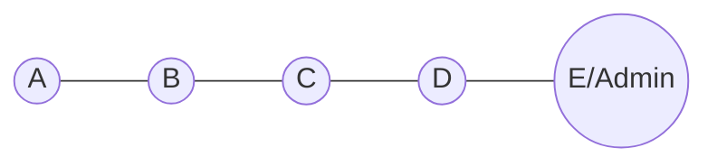
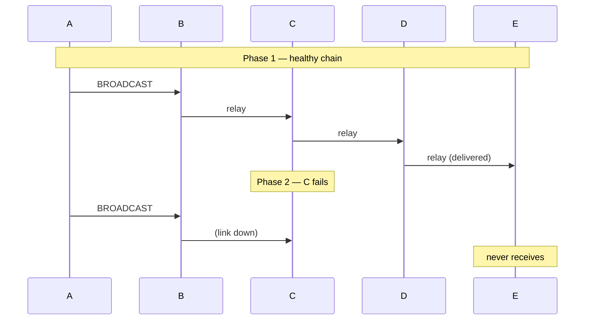

# Example 04 — Relay Failure Recovery

## Objective

Demonstrate multi-hop broadcast relay across a linear chain, then show that a
relay node failure correctly severs delivery to nodes beyond the break.

## Network Topology



## Message Flow



## Prerequisites

- Node.js 20+

## How to Run

```bash
npm run demo 4
```

## Expected Behaviour

- Phase 1: A's broadcast reaches E through relays B, C, D.
- Phase 2: With C removed, the chain is severed; A's broadcast never reaches E.

## Success Criteria

- Delivery succeeds before failure (`deliveredBeforeFailure >= 1`).
- Delivery is isolated after failure (`deliveredAfterFailure === 0`).
- `summary.success === true`.

## Outputs

- `results/logs/04-relay-failure.log`
- `results/traces/04-relay-failure.trace.json`
- `results/metrics/04-relay-failure.metrics.json`
- `results/metrics/04-relay-failure.summary.json`
