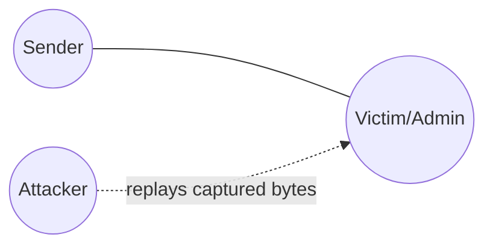
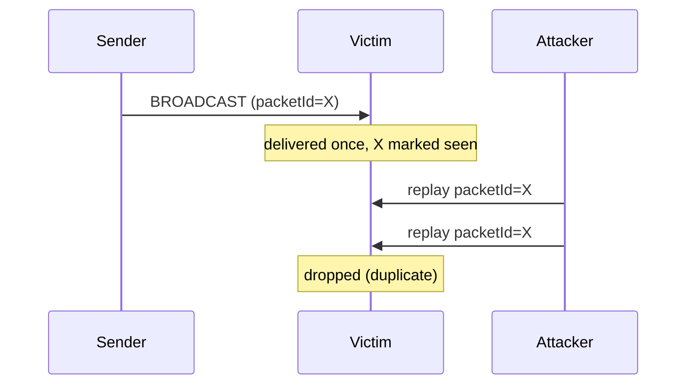

# Example 05 — Replay Attack Detection

## Objective

Demonstrate that re-injecting a previously-seen packet (a replay attack) is
suppressed by NINE's duplicate-detection layer, so the victim only ever
delivers the message once.

## Network Topology



## Message Flow



## Prerequisites

- Node.js 20+

## How to Run

```bash
npm run demo 5
```

## Expected Behaviour

The legitimate broadcast is delivered once. Five subsequent replays of the
exact same wire bytes are detected as duplicates and dropped. The delivered
count remains 1.

## Success Criteria

- Exactly 1 legitimate delivery.
- 0 additional deliveries after 5 replays.
- `duplicatesDetected >= 5`.
- `summary.success === true`.

## Outputs

- `results/logs/05-replay-attack.log`
- `results/traces/05-replay-attack.trace.json`
- `results/metrics/05-replay-attack.metrics.json`
- `results/metrics/05-replay-attack.summary.json`
