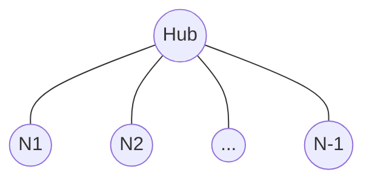

# Example 06 — Benchmark & Performance

## Objective

Measure broadcast latency, secure-message latency, throughput, and delivery
rate across increasing mesh sizes (5, 10, 20, 50 nodes). Export CSV files for
charts in Excel and research papers.

## Network Topology

Star topology of increasing size (Hub + N-1 peers).



## Prerequisites

- Node.js 20+

## How to Run

```bash
npm run demo 6
```

## Expected Behaviour

For each mesh size the runner measures:
- **Broadcast latency** — time for one broadcast to reach all peers.
- **Secure latency** — time for one encrypted message to reach the Hub.
- **Throughput** — broadcasts per second in a tight loop.
- **Delivery rate** — fraction of peers that received the broadcast.

## Success Criteria

- All sizes achieve 100% delivery.
- CSV files are produced under `results/metrics/`.

## CSV Exports

| File | Columns |
|------|---------|
| `benchmark.csv` | nodes, broadcast_latency_ms, secure_latency_ms, throughput_msgs_per_sec, delivery_rate |
| `latency.csv` | nodes, broadcast_ms, secure_ms |
| `throughput.csv` | nodes, msgs_per_sec |
| `packet-loss.csv` | nodes, delivery_rate, loss_rate |

These are directly importable into Excel / plotting tools.

## Outputs

- `results/logs/06-benchmark.log`
- `results/traces/06-benchmark.trace.json`
- `results/metrics/06-benchmark.{metrics,summary}.json`
- `results/metrics/benchmark.csv`, `latency.csv`, `throughput.csv`, `packet-loss.csv`
