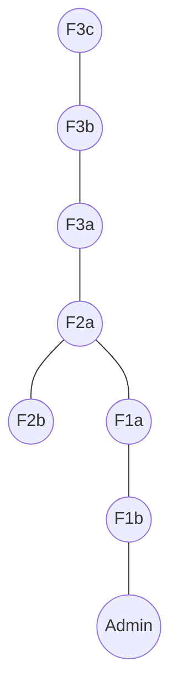
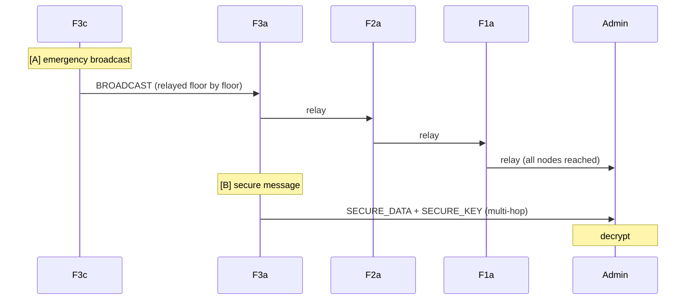

# Example 07 — Multi-Node Mesh Communication

## Objective

Demonstrate a realistic multi-floor building mesh (8 nodes) with:
- A far-node broadcast reaching every node across multiple hops.
- A multi-hop encrypted message to the Admin.

## Network Topology



## Message Flow



## Prerequisites

- Node.js 20+

## How to Run

```bash
npm run demo 7
```

## Expected Behaviour

- Scenario A: F3c's emergency broadcast reaches all 7 other nodes.
- Scenario B: F3a's encrypted message is routed multi-hop and decrypted by the Admin.

## Success Criteria

- Broadcast reaches all 7 nodes.
- Admin receives exactly 1 decrypted secure message.
- `summary.success === true`.

## Outputs

- `results/logs/07-multi-node-mesh.log`
- `results/traces/07-multi-node-mesh.trace.json`
- `results/metrics/07-multi-node-mesh.{metrics,summary}.json`
